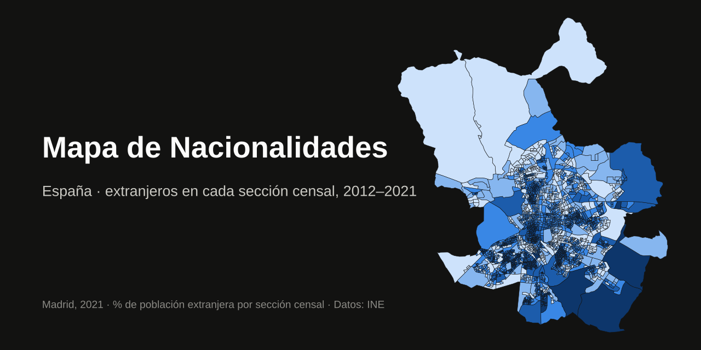
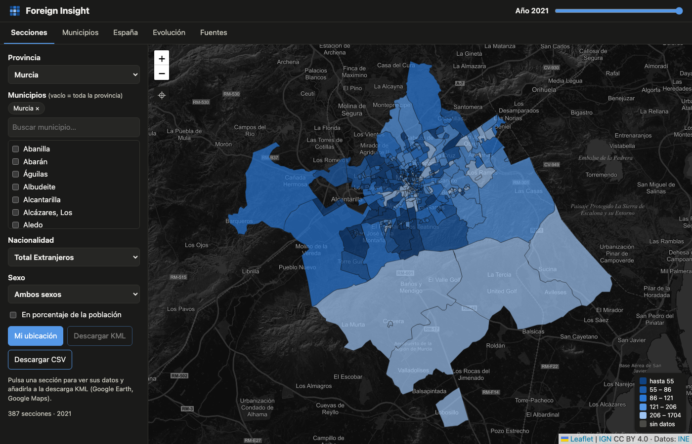
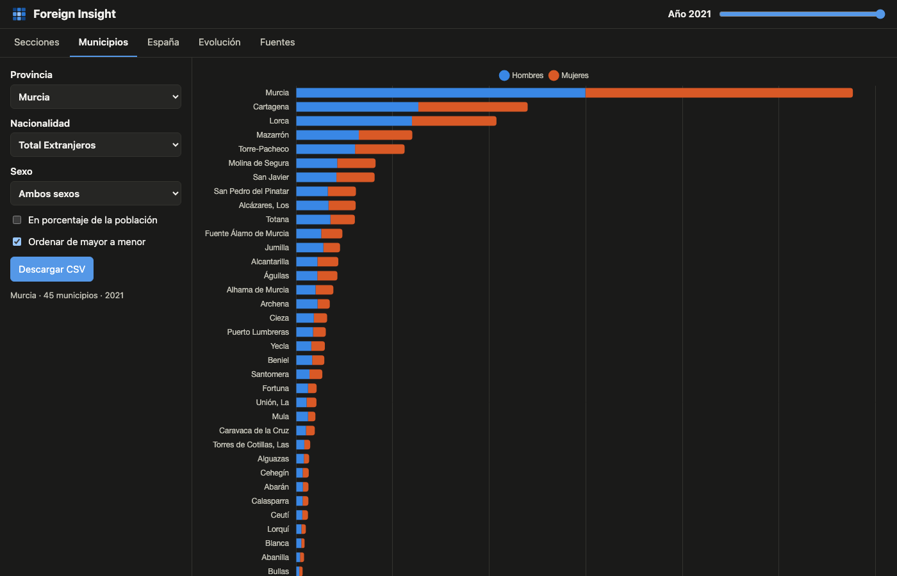
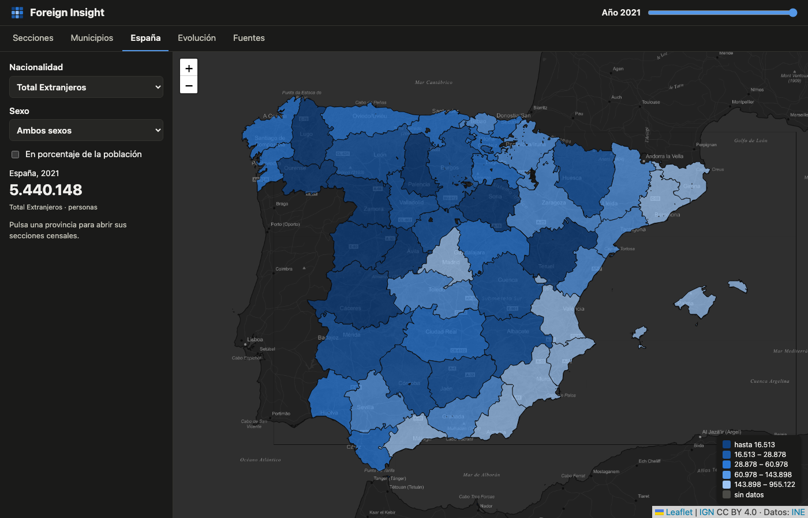
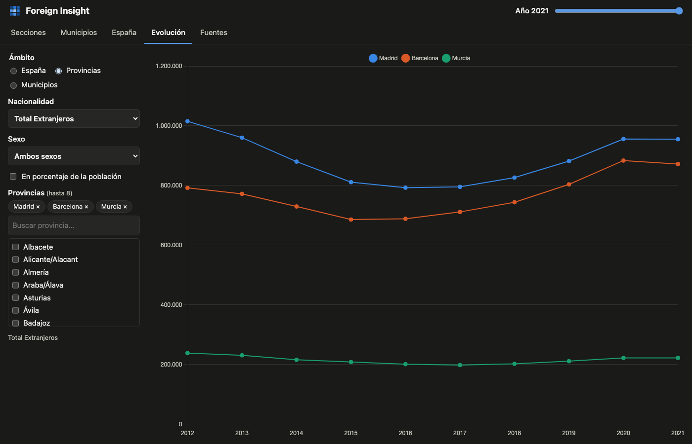

<p align="center">
  
</p>

<h1 align="center">Mapa de Nacionalidades</h1>

<p align="center">
  <a href="https://github.com/GeiserX/secciones-nacionalidades/actions/workflows/ci.yml"></a>
  <a href="https://github.com/GeiserX/secciones-nacionalidades/blob/main/LICENSE"></a>
  <a href="https://nacionalidades.geiser.cloud"></a>
  <a href="https://github.com/GeiserX/secciones-nacionalidades/stargazers"></a>
  <a href="https://github.com/GeiserX/awesome-spain#readme"></a>
</p>

<p align="center">
  <strong>Extranjeros en España por nacionalidad y sección censal, con datos del INE</strong>
</p>

---

**Mapa de Nacionalidades** muestra cuántas personas de cada nacionalidad viven en cada una de las más de 36.000 **secciones censales** de España, de 2012 a 2021, con datos abiertos del [Instituto Nacional de Estadística (INE)](https://www.ine.es/).

Es una aplicación antigua: la desarrollé hacia 2017 y la he renovado con IA.

**Ábrela en el navegador: https://nacionalidades.geiser.cloud** — sin instalar nada, también en el móvil. También hay aplicación para Android e iPhone, que funciona sin conexión.

## Funcionalidades

- **Mapa por secciones censales**: elige provincia, municipios, nacionalidad y sexo, en personas o en porcentaje de la población
- **Mi ubicación**: encuentra tu sección censal (la posición no sale del dispositivo)
- **Descarga KML y CSV**: marca secciones en el mapa y llévatelas a Google Earth o Google Maps, o descarga los datos de la vista en CSV
- **Municipios**: gráfico de todos los municipios de una provincia, con hombres y mujeres
- **España**: mapa por provincias y total nacional
- **Evolución**: serie 2012-2021 de España, de hasta 8 provincias o de hasta 8 municipios

## Capturas de pantalla

| Secciones censales | Municipios de una provincia |
|:---:|:---:|
|  |  |

| España por provincias | Evolución 2012-2021 |
|:---:|:---:|
|  |  |

> **Datos disponibles: 2012–2021.** El INE dejó de publicar la población por nacionalidad a nivel de sección censal a partir de 2022.

## Fuentes de datos

| Dato | Fuente |
|---|---|
| Población por sexo y nacionalidad en cada sección censal | INE, Estadística del Padrón Continuo: https://www.ine.es/dyngs/INEbase/es/operacion.htm?c=Estadistica_C&cid=1254736177012&menu=resultados&idp=1254734710990 |
| Contornos de las secciones censales, un fichero por año | INE, Datos Abiertos, Cartografía secciones censales: https://www.ine.es/dyngs/DAB/index.htm?cid=1389 |
| Mapa base | IGN Base, © Instituto Geográfico Nacional, CC BY 4.0 |

El INE cambió dos nombres de grupos a lo largo de la serie: «Total Africa» pasó a «Total África» en 2018, y en 2021 «Total Europa No Comunitaria» pasó a «Total Resto de Europa», que desde entonces incluye al Reino Unido. La aplicación usa los nombres de 2021 en todos los años.

## Cómo funciona

Es una web estática: no hay servidor. Los datos del INE se convierten una sola vez en ficheros pequeños (uno por provincia y año) que la página descarga según los necesita, y la misma web va dentro de las aplicaciones de Android e iOS.

```bash
npm ci
npm run dev      # http://localhost:5173
npm test
```

Con Docker:

```bash
docker build -t mapa-nacionalidades . && docker run -p 8080:8080 mapa-nacionalidades
```

Cómo se regeneran los datos: [docs/development.md](docs/development.md).

## Licencia

[GPL-3.0-or-later](LICENSE)
